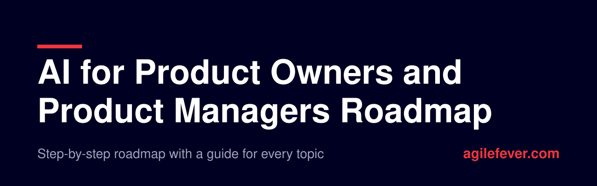

# AI for Product Owners and Product Managers Roadmap

> AI for Product Owners and Product Managers Roadmap - A step-by-step roadmap to use GenAI and Agentic AI in product work, scope AI features, and own AI-powered products, with a blog for every topic

## Table of Contents

- [Who is a Product Owner or Product Manager who works with AI?](#who-is-a-product-owner-or-product-manager-who-works-with-ai)
- [The AI Product Lifecycle](#the-ai-product-lifecycle)
- [How to Use This Roadmap](#how-to-use-this-roadmap)
- [Step 0: Must Know](#step-0-must-know)
- [Step 1: GenAI and Agentic AI in Product Terms](#step-1-genai-and-agentic-ai-in-product-terms)
- [Step 2: Choosing AI Tools for Product Work](#step-2-choosing-ai-tools-for-product-work)
- [Step 3: Prompting and Context for Product Work](#step-3-prompting-and-context-for-product-work)
- [Step 4: PRDs, User Stories, and Acceptance Criteria](#step-4-prds-user-stories-and-acceptance-criteria)
- [Step 5: Backlog, Prioritization, and the Roadmap Narrative](#step-5-backlog-prioritization-and-the-roadmap-narrative)
- [Step 6: Customer Research and Competitive Analysis](#step-6-customer-research-and-competitive-analysis)
- [Step 7: Scoping AI Features: Prompting, RAG, or Fine-Tuning](#step-7-scoping-ai-features-prompting-rag-or-fine-tuning)
- [Step 8: Hallucination, Risk, and Guardrails](#step-8-hallucination-risk-and-guardrails)
- [Step 9: Evaluation Design: Does the AI Feature Work?](#step-9-evaluation-design-does-the-ai-feature-work)
- [Step 10: Agentic Features and Tool Use](#step-10-agentic-features-and-tool-use)
- [Step 11: Responsible AI and Human-in-the-Loop](#step-11-responsible-ai-and-human-in-the-loop)
- [Step 12: Owning the AI Roadmap](#step-12-owning-the-ai-roadmap)
- [Step 13: Prove Your Skills: Capstone and Certification](#step-13-prove-your-skills-capstone-and-certification)
- [Learn This Roadmap with a Mentor](#learn-this-roadmap-with-a-mentor)
- [License](#license)

### Prepared and maintained by [AgileFever](https://agilefever.com)

### Follow AgileFever

- [LinkedIn](https://www.linkedin.com/company/agilefever/)
- [YouTube](https://www.youtube.com/@AgileFever)
- [X/Twitter](https://x.com/agilefever)
- [Website](https://agilefever.com)

## Learn with AgileFever

- [Gen AI and Agentic AI for Product Owners/Product Managers](https://agilefever.com/generative-ai/gen-ai-agentic-ai-for-product-owners-managers/)

---

> **Note: We keep updating this roadmap with new topics and blogs.**

---

### Who is a Product Owner or Product Manager who works with AI?

A Product Owner (PO) or Product Manager (PM) spends most of the week on requirements, roadmaps, customer research, prioritization, and talking to stakeholders. AI can cut the effort behind all of this. It can also become part of the product itself, and that is where the job changes.

There are two sides to AI in a product role:

- **Using AI in your own work:** drafting PRDs and user stories, synthesizing interviews, building roadmap narratives, and analyzing feedback faster and with better structure.
- **Owning AI inside the product:** deciding whether an AI feature is feasible, choosing between prompting, RAG, and fine-tuning with the ML team, defining how quality is measured, and setting the rules for when a human steps in.

A PM who only uses ChatGPT for brainstorming covers the first side in a shallow way. A PM who can scope an AI feature, read an evaluation, and set escalation rules covers both. This roadmap takes us from the first to the second.

### The AI Product Lifecycle

Most AI product work follows the same path. This roadmap is ordered to match it.

| Phase | What you do | Steps in this roadmap |
| --- | --- | --- |
| Learn the basics | Know what GenAI and agents are and what they are not | Step 0, Step 1, Step 2 |
| Speed up your own work | Use AI for PRDs, prioritization, roadmaps, and research | Step 3, Step 4, Step 5, Step 6 |
| Scope the feature | Decide what an AI feature can realistically do and how | Step 7, Step 8 |
| Prove it works | Design evaluations and read the results | Step 9 |
| Build and ship | Work with agents, add human oversight, handle risk | Step 10, Step 11 |
| Lead | Own the AI roadmap and show your skills | Step 12, Step 13 |

### How to Use This Roadmap

This roadmap is for anyone in a product role. No coding is needed to follow it.

- Follow the steps in order. Each step builds on the previous one.
- Inside each step, read the blogs in the given order. Each one covers one idea in plain words.
- After every step, ask yourself: "If my engineering lead asked me about this tomorrow, could I explain it and decide?" If yes, move on.
- Try each idea on your own backlog, your own PRD, or your own customer notes. Reading alone will not build the skill.
- Share the roadmap with your engineering and data leads. A shared vocabulary makes planning meetings shorter.
- If a topic has no blog link yet, it is listed as plain text. We will add the link when the blog is published.

Let's get started.

### Step 0: Must Know

Before going deeper, we must know the words that come up in every AI product conversation. These are the terms engineers and data teams will use in your first planning meeting.

- [Artificial Intelligence Terms: An A to Z AI Glossary](https://agilefever.com/artificial-intelligence-terms-ai-glossary-examples/)
- [What Is Agentic AI? A Complete Beginner's Guide](https://agilefever.com/what-is-agentic-ai/)
- [Agentic AI vs Generative AI: What Is the Difference?](https://agilefever.com/agentic-ai-vs-generative-ai/)
- RAG, fine-tuning, and prompting in one page (a blog is coming)

Six words to be comfortable with: LLM, prompt, context, RAG, fine-tuning, and agent. The next steps explain each in the context of product work.

**Check yourself:** Can you explain RAG, fine-tuning, and an agent to a stakeholder in two sentences each?

### Step 1: GenAI and Agentic AI in Product Terms

In this step, we learn what a large language model does well, where it fails, and how an agent differs from a chatbot. We keep it at the level a product person needs to ask good questions.

- [Large Language Models (LLMs): A Complete Guide](https://agilefever.com/large-language-models-llm-guide/)
- [Generative Learning vs Discriminative Learning](https://agilefever.com/generative-learning-vs-discriminative-learning/)
- [Agentic AI Architecture Explained: Planner, Memory, Tools, and Reflection](https://agilefever.com/agentic-ai-architecture-planner-memory-tools-reflection/)
- [How to Start Learning AI Agents](https://agilefever.com/how-to-start-learning-ai-agents/)

**Check yourself:** Can you say what an agent can do that a chatbot cannot?

### Step 2: Choosing AI Tools for Product Work

Different assistants suit different tasks. Here we compare the main ones and look at the wider tool landscape, so we pick a tool for the job and not by habit.

- [ChatGPT vs Grok vs Gemini vs Claude vs Perplexity](https://agilefever.com/chatgpt-vs-grok-vs-gemini-vs-claude-vs-perplexity/)
- [Top AI Tools Revolutionizing Every Industry in 2026](https://agilefever.com/ai-tools/)
- [AI Tools for Software Teams: Where AI Helps in Coding, Testing, Docs and Ops](https://agilefever.com/ai-tools-for-software-teams/)
- [Python for AI: The Free 6-Hour Course and Who Should Take It First](https://agilefever.com/python-for-ai-free-course-who-should-take-it/)

**Check yourself:** Do you know which tool you would pick for research, for writing, and for data work, and why?

### Step 3: Prompting and Context for Product Work

Good output depends on what we give the model. In this step, we learn to write prompts with a role, context, task, and format, and to supply the right documents and data.

- [Prompt Engineering vs Context Engineering: What Changes in Practice](https://agilefever.com/prompt-engineering-vs-context-engineering/)
- [Source Codes to Build Your First AI Assistant with Generative AI](https://agilefever.com/source-codes-build-ai-assistant-with-generative-ai/)
- [AI Training for Product Teams: Roles, Skills and a 6-Week Plan](https://agilefever.com/ai-training-for-product-teams/)
- [GenAI and Agentic AI Skills Every Product Owner/Manager Needs in 2026](https://agilefever.com/genai-agentic-ai-skills-for-product-owners-managers/)

**Check yourself:** Can you write a prompt that gives the model a role, the context, the task, and the output format?

### Step 4: PRDs, User Stories, and Acceptance Criteria

Turning a requirement into a full PRD is slow because edge cases get skipped under deadline pressure. In this step, we use AI to draft the PRD, the acceptance criteria, and a list of edge cases, then review them as the owner.

- [20 Use Cases for Generative AI and Agentic AI Across Every Agile Product Owner Role](https://agilefever.com/genai-agentic-ai-use-cases-agile-product-owner-role/)
- [20 Use Cases for Generative AI and Agentic AI Across Every Agile Product Manager Role](https://agilefever.com/20-use-cases-for-generative-ai-and-agentic-ai-across-every-agile-product-manager-role/)
- [20 Use Cases for Generative AI and Agentic AI Across Every Agile Business Analyst Role](https://agilefever.com/genai-agentic-ai-use-cases-agile-business-analyst-role/)
- Writing acceptance criteria and edge cases with AI (a blog is coming)

**Check yourself:** Can you take one real requirement and produce a PRD with acceptance criteria and edge cases in a single working session?

### Step 5: Backlog, Prioritization, and the Roadmap Narrative

Here we learn to feed usage data and customer feedback into AI to rank backlog items, and then to produce a roadmap story we can defend in front of stakeholders. The numbers still come from us. AI helps with structure and wording.

- [The Hidden Power of Kanban Backlog Management for Maximum Efficiency](https://agilefever.com/the-hidden-power-of-kanban-backlog-management-for-maximum-efficiency/)
- [OKR Visualization: Achieve Goals Faster](https://agilefever.com/enhance-goal-achievement-with-okr-visualization-unveiling-the-power-of-visual-tracking/)
- [SAFe Product Manager: Key Responsibilities Explained](https://agilefever.com/safe-product-manager-responsibilities-demystified/)
- [Agile Product Management (APM) Certification: Who Should Take It](https://agilefever.com/agile-product-management-apm-certification/)
- Prioritizing a backlog from usage and feedback data with AI (a blog is coming)

**Check yourself:** Can you explain why your top three backlog items are ranked as they are, using data and not opinion?

### Step 6: Customer Research and Competitive Analysis

Interview notes, support tickets, and competitor pages pile up faster than we can read them. In this step, we learn to turn raw notes into structured, shareable insights and to keep a clear line between what the customer said and what the model inferred.

- [20 Use Cases for Generative AI and Agentic AI Across Every Agile Role](https://agilefever.com/generative-ai-agentic-ai-use-cases/)
- [Prototyping in Design Thinking: Complete Guide with Examples](https://agilefever.com/prototyping-in-design-thinking-complete-guide-with-examples/)
- [Product Owner to AI Product Owner: A Career Transition Roadmap](https://agilefever.com/product-owner-to-ai-product-owner-roadmap/)
- Interview notes to structured insights with AI (a blog is coming)
- Competitive teardown synthesis with AI (a blog is coming)

**Check yourself:** Can you turn ten interview notes into five insights, each tied to a quote?

### Step 7: Scoping AI Features: Prompting, RAG, or Fine-Tuning

This is where the PM role changes. We learn the trade-offs between prompting, RAG, and fine-tuning at the depth needed to make decisions with the data and ML teams, so we do not promise what cannot ship.

- [GenAI and Agentic AI for Product Owners and Product Managers: The Complete Guide](https://agilefever.com/genai-agentic-ai-product-owners-managers-complete-guide/)
- [Building Successful AI Products with Robust Architecture (Part 1)](https://agilefever.com/building-successful-ai-products-with-robust-architecture/)
- [Single-Agent vs Multi-Agent Systems: What Is the Difference?](https://agilefever.com/single-agent-system-vs-multi-agent-system/)
- RAG vs fine-tuning vs prompting: a decision guide for PMs (a blog is coming)

**Check yourself:** Can you tell the ML team what you need to know before you commit to a date for an AI feature?

### Step 8: Hallucination, Risk, and Guardrails

Models state wrong things with confidence. In this step, we learn how hallucination shows up in a product, what it costs the user, and which basic defenses reduce the risk.

- [Prompt Injection and Guardrails: Basic Defenses Every AI Agent Needs](https://agilefever.com/prompt-injection-guardrails/)
- [AI Transformation Readiness: A Self-Assessment for Business Leaders](https://agilefever.com/ai-transformation-readiness-self-assessment/)
- Hallucination risk basics for product managers (a blog is coming)

**Check yourself:** Can you name the three places in your product where a wrong answer would hurt the user most?

### Step 9: Evaluation Design: Does the AI Feature Work?

Evaluation is the skill that separates PMs who manage AI from PMs who use it. We learn what a golden set is, how rubrics, human raters, and LLM judges compare, and what to do when a new model version moves the scores.

- [How to Evaluate an LLM Application: Test Sets, Rubrics and Regression Checks](https://agilefever.com/evaluate-llm-application/)
- [Measuring Training Impact: From Completion Rates to Delivery Outcomes](https://agilefever.com/measuring-ai-training-impact-delivery-outcomes/)
- Building a golden set for an AI feature (a blog is coming)
- LLM-as-judge vs human raters (a blog is coming)

**Check yourself:** Can you describe a golden set for one feature in your product and say who would label it?

### Step 10: Agentic Features and Tool Use

Agents can call tools, keep memory, and run multi-step tasks. In this step, we learn enough about how agents are built to scope them, write requirements for them, and ask the right questions about cost and failure modes.

- [Agentic AI Architecture Explained: Planner, Memory, Tools, and Reflection](https://agilefever.com/agentic-ai-architecture-planner-memory-tools-reflection/)
- [Model Context Protocol (MCP) Explained for Developers](https://agilefever.com/model-context-protocol-explained/)
- [AI Agent Frameworks Compared: LangGraph, CrewAI and AutoGen](https://agilefever.com/ai-agent-frameworks-compared/)
- [Solution Architecture Patterns for Agentic AI Systems: A Practical Primer](https://agilefever.com/agentic-ai-architecture-patterns-solution-architects/)

**Check yourself:** Can you list what the agent is allowed to do, what it must ask about, and what it must never do?

### Step 11: Responsible AI and Human-in-the-Loop

Before an AI feature ships, we need rules for when it must hand off to a person, and a basic grounding in responsible AI practice, including awareness of the NIST AI Risk Management Framework. This step covers escalation rules and the checks to run before launch.

- [Prompt Injection and Guardrails: Basic Defenses Every AI Agent Needs](https://agilefever.com/prompt-injection-guardrails/)
- [AI for Business Leaders: Board-Level Talking Points](https://agilefever.com/ai-board-talking-points-business-leaders/)
- Designing human-in-the-loop escalation rules for agentic features (a blog is coming)
- Responsible AI checklist before launch (a blog is coming)

**Check yourself:** Can you write three escalation rules for one agentic feature?

### Step 12: Owning the AI Roadmap

In this step, we look at who owns what when AI enters the roadmap, how the PO and PM roles split the work, and how to plan your own move into an AI-focused product role.

- [Product Owner vs Product Manager: Who Owns the AI Roadmap?](https://agilefever.com/product-owner-vs-product-manager-ai-roadmap/)
- [SAFe Product Owner vs Product Manager: Who Owns What on a Release Train](https://agilefever.com/safe-product-owner-vs-product-manager/)
- [Essential SAFe Training for Product Owners and Managers](https://agilefever.com/unlock-success-safe-training-for-product-owners-and-managers/)
- [AI Learning Plan for Working Professionals: 12 Weeks, 5 Hours a Week](https://agilefever.com/ai-learning-plan-for-working-professionals/)

**Check yourself:** Can you explain who decides what goes on the AI roadmap in your team?

### Step 13: Prove Your Skills: Capstone and Certification

Skills are best shown with work. We finish by building a real artifact, such as a PRD, a roadmap narrative, and an evaluation plan for one AI feature, and by choosing a credential if we want one. AgileFever's certification ends with a final test and practical exercises from each module.

- [Inside AgileFever Capstones: What You Build and What It Proves](https://agilefever.com/agilefever-capstones-what-they-prove/)
- [Which AI Program Is Right for Experienced IT Professionals?](https://agilefever.com/which-ai-program-is-right-for-experienced-it-professionals/)
- Interview questions for AI product roles (a blog is coming)

Interview practice: take your own AI feature idea and explain, in five minutes, what it does, how you would build it, how you would measure it, and when a human steps in.

**Check yourself:** Can you present one AI feature from idea to evaluation plan without notes?

### Learn This Roadmap with a Mentor

This roadmap follows the same path as the live Gen AI and Agentic AI for Product Owners/Product Managers certification at AgileFever. If you want to work through it with an instructor, practical exercises, and a capstone project, take a look at the [course page](https://agilefever.com/generative-ai/gen-ai-agentic-ai-for-product-owners-managers/).

### License

This roadmap is licensed under CC BY 4.0. You may share and adapt it with credit to AgileFever.
